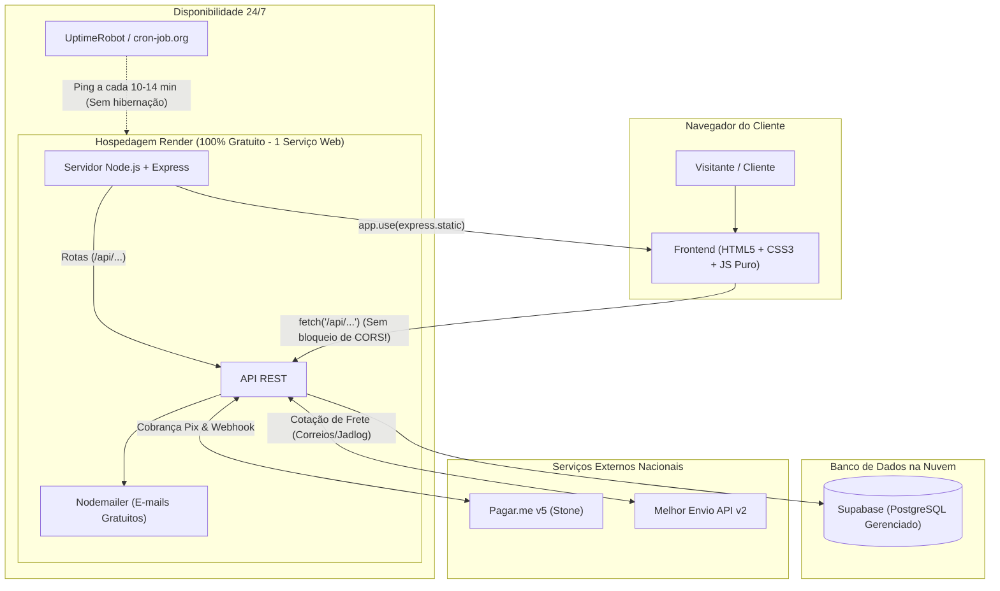
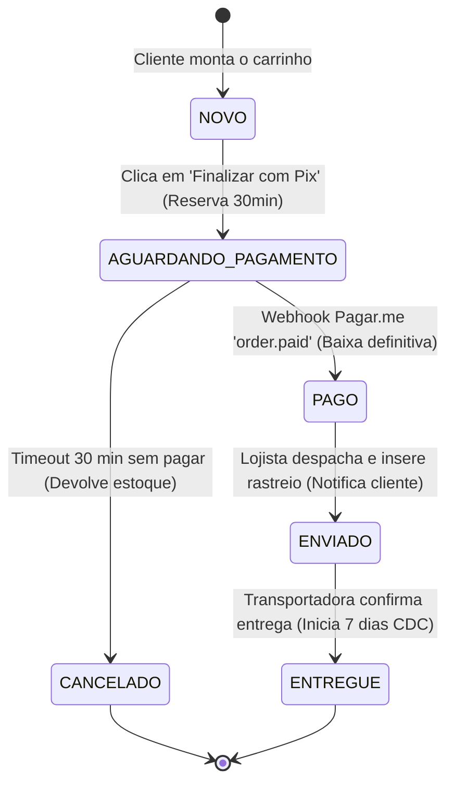

# 📜 Diretrizes e Especificação do Projeto — Canivete da Roça (PI2)

Documento oficial de alinhamento técnico, arquitetural e regras de negócio do **Projeto Integrador II (PI2)** para a plataforma de e-commerce **Canivete da Roça**.

---

## 🎯 1. Visão Geral e Escopo

* **Nicho do E-commerce:** Cutelaria artesanal, canivetes, facas, strops de couro e pastas para polimento/afiação de lâminas.
* **Proposta Arquitetural:** Simplicidade máxima para estudantes (HTML/CSS/JS puro no Frontend + Node.js/Express no Backend), rodando unificados no **Render** com custo de infraestrutura fixo de **R$ 0,00**.
* **Escopo de Pagamento:** Exclusivo via **PIX (Pagar.me v5)** com QR Code dinâmico e expiração de 30 minutos.
* **Escopo Logístico:** Cálculo de frete dinâmico e geração de envios integrados à API do **Melhor Envio v2** (Correios e Jadlog).
* **Notificações:** Disparo de e-mails transacionais gratuitos via **Nodemailer (Gmail)**.

---

## 🏗️ 2. Arquitetura Técnica e Stack



### 📊 Resumo das Tecnologias e Custos

| Camada | Tecnologia | Plataforma / Hospedagem | Custo | Finalidade Principal |
| :--- | :--- | :--- | :--- | :--- |
| **Frontend** | HTML5, CSS3, JS Vanilla | **Render** (junto com a API) | R$ 0,00 | Telas leves, sem build, facilidade de edição por qualquer membro. |
| **Backend** | Node.js + Express | **Render** (Web Service Free) | R$ 0,00 | Rotas limpas, leitura direta de JSON (`req.body`), regras comerciais. |
| **Keep-Alive** | UptimeRobot / cron-job | Web gratuito | R$ 0,00 | Pings a cada 10-14 min no `/api/health` para evitar hibernação. |
| **Banco de Dados**| PostgreSQL | **Supabase** (Free Tier) | R$ 0,00 | Armazenamento de produtos, pedidos, clientes e reservas. |
| **Pagamentos** | API REST v5 (Stone) | **Pagar.me** (Sandbox / Prod) | Por transação | Geração de Pix dinâmico, código copia-e-cola e Webhook `order.paid`. |
| **Logística** | API v2 de Cotação | **Melhor Envio** (Sandbox / Prod)| R$ 0,00 (API) | Cotação em tempo real de PAC, SEDEX e Jadlog com base no CEP. |
| **E-mails** | Nodemailer (SMTP Gmail) | Google App Password | R$ 0,00 (até 500/dia)| Notificação de pedido recebido, pagamento aprovado e código de rastreio. |

---

## 📦 3. Catálogo, Produtos e Regras de Estoque

### RN01 — Tipos de Produtos e Dimensões Físicas
1. **Itens Simples:** Peças avulsas (ex: canivete campeiro, tira de couro, pasta de polimento verde jacaré).
2. **Kits e Combos:** Agrupamentos de itens (ex: *Kit Afiação Completo* = 1 Strop de Couro + 1 Pasta de Polimento + 1 Pedra de Afiar).
   * **Controle de Estoque dos Kits:** A disponibilidade de um kit virtual é dada pelo menor estoque de seus componentes:  
     $$\text{Estoque do Kit} = \min(\text{estoque}_{\text{item 1}}, \text{estoque}_{\text{item 2}}, \dots)$$
3. **Obrigatoriedade para Frete:** Todo produto físico cadastrado deve obrigatoriamente possuir:
   * **Peso** (em gramas ou kg);
   * **Dimensões** (altura, largura, comprimento em cm).  
   * *Motivo:* A API do Melhor Envio rejeita cotações sem essas informações.

### RN02 — Ruptura de Estoque ("Avise-me quando chegar")
* Quando o saldo de um item estiver zerado (`estoque <= 0`):
  * O botão **"Comprar"** fica desabilitado.
  * Surge o formulário **"Avise-me quando chegar"** (coleta Nome e E-mail do cliente).
  * Os dados são salvos na tabela `avise_me` do Supabase.
  * Quando o estoque for reabastecido no painel admin, o backend notifica os clientes interessados via e-mail.

---

## 💳 4. Pagamento Exclusivo via PIX (Pagar.me v5)

### RN03 — Modalidade Única
* A loja trabalha exclusivamente com **PIX** (não aceita cartão de crédito nem boleto bancário nesta versão), simplificando a implementação e garantindo liquidação instantânea.

### RN04 — Checkout, Reserva de Estoque e TTL de 30 Minutos
1. **Geração do Pix:** Ao clicar em "Finalizar Pedido", o backend cria uma `order` na API da Pagar.me com método `pix`.
2. **Retorno:** A API devolve o código Pix "copia e cola" e a URL da imagem do QR Code.
3. **Reserva Temporária:** No instante da geração, os itens do pedido ficam no estado `RESERVADO` no banco.
4. **Tempo de Expiração (TTL):** O Pix tem validade estrita de **30 minutos**.
   * A tela de checkout exibe um **cronômetro regressivo visual** para o cliente.
   * Se os 30 minutos passarem sem pagamento: o pedido é alterado para `CANCELADO` e os itens voltam ao estoque disponível.

### RN05 — Webhooks e Confirmação Automática
* **Rota do Webhook:** `POST /api/webhooks/pagarme` (protegida por validação de assinatura).
* **Evento `order.paid`:**
  1. Verifica se o pedido está `AGUARDANDO_PAGAMENTO`.
  2. Altera o status para `PAGO`.
  3. Confirma a baixa definitiva do estoque.
  4. Dispara e-mail automático com os detalhes da compra via Nodemailer.
  5. Envia o pedido para a fila de expedição.
* **Evento `charge.payment_failed` / Cancelamento:**
  1. Altera status para `CANCELADO`.
  2. Devolve os itens ao estoque disponível.

---

## 🚚 5. Lógica de Frete e Logística (Melhor Envio v2)

### RN06 — Cotação Dinâmica de Frete
* **Onde ocorre:**
  * Na página do produto (estimativa para 1 item).
  * No carrinho/checkout (cálculo consolidado com todos os itens).
* **Cálculo de Pacote (Backend):**
  * O backend soma o peso total dos produtos e estima a embalagem para enviar à rota `/api/v2/me/shipment/calculate` da API do Melhor Envio.
* **Transportadoras Aceitas:**
  * **Correios:** PAC e SEDEX.
  * **Jadlog:** .Package e .Com.
* **Exibição na Tela:** Nome do serviço, valor do frete (R$) e prazo estimado em dias úteis.
* **Seleção:** Ao escolher, o `servico_id`, o valor do frete e o prazo são salvos no pedido.

### RN07 — Pós-Pagamento e Rastreio
* Após o status `PAGO`, o lojista gera a etiqueta de frete no Melhor Envio.
* O código de rastreamento é registrado no pedido no Supabase.
* O status do pedido avança para `ENVIADO` e o cliente recebe um e-mail com o link de rastreamento da encomenda.

---

## 🔄 6. Máquina de Estados do Pedido (Lifecycle)



| Estado | O que significa? | Efeito no Estoque | Ação do Sistema |
| :--- | :--- | :--- | :--- |
| `NOVO` | Carrinho em montagem | Nenhum | Aguarda cliente preencher dados |
| `AGUARDANDO_PAGAMENTO` | QR Code Pix gerado na tela | **Reservado** (30 min) | Dispara cronômetro regressivo na tela |
| `PAGO` | Pix confirmado pelo banco | **Baixado definitivamente** | Envia e-mail de confirmação de compra |
| `CANCELADO` | Tempo esgotado ou pagamento recusado | **Estornado** para a loja | Libera itens para outros compradores |
| `ENVIADO` | Pacote postado na transportadora | Já baixado | Envia e-mail com código de rastreio |
| `ENTREGUE` | Pacote entregue ao cliente | Já baixado | Inicia contagem de 7 dias de arrependimento |

---

## ⚖️ 7. Políticas de Pós-Venda e Suporte Legal

### RN08 — Prazos Legais e Garantia
1. **Direito de Arrependimento (Art. 49 do CDC):**
   * O cliente tem até **7 dias corridos** após o status `ENTREGUE` para desistir da compra.
   * O produto deve ser devolvido sem marcas de uso, na embalagem original.
   * Reembolso integral (produto + frete) devolvido via Pix.
2. **Garantia de Fabricação (90 dias):**
   * Cobertura legal contra defeitos de fabricação (especialmente para strops de couro artesanais).
   * Suporte realizado via WhatsApp ou e-mail com envio de foto/vídeo da peça.

---

## 📧 8. Como Enviar E-mails Gratuitos no Node.js (Nodemailer)

Exemplo prático de como o backend enviará o e-mail de confirmação sem pagar nada:

```javascript
// backend/src/services/emailService.js
const nodemailer = require('nodemailer');

const transporter = nodemailer.createTransporter({
  service: 'gmail',
  auth: {
    user: process.env.EMAIL_USER, // canivetedaroca.pi2@gmail.com
    pass: process.env.EMAIL_PASS  // Senha de App gerada no Google
  }
});

async function enviarConfirmacaoPedido(cliente, pedido) {
  const mailOptions = {
    from: '"Canivete da Roça" <canivetedaroca.pi2@gmail.com>',
    to: cliente.email,
    subject: `🗡️ Pedido #${pedido.id} Confirmado com Sucesso!`,
    html: `
      <h2>Olá, ${cliente.nome}!</h2>
      <p>Seu pagamento via Pix foi confirmado com sucesso.</p>
      <p><strong>Valor Total:</strong> R$ ${pedido.valor_total.toFixed(2)}</p>
      <p>Já estamos preparando sua encomenda para envio via ${pedido.forma_envio}.</p>
      <p>Assim que postarmos, enviaremos seu código de rastreio!</p>
    `
  };

  await transporter.sendMail(mailOptions);
}

module.exports = { enviarConfirmacaoPedido };
```

---

## 🗄️ 9. Estrutura das Tabelas do Banco (Supabase)

Para orientar a equipe de banco de dados, as tabelas essenciais são:

1. **`produtos`**: `id`, `nome`, `descricao`, `preco`, `tipo ('simples'/'kit')`, `estoque`, `peso_g`, `altura_cm`, `largura_cm`, `comprimento_cm`, `imagem_url`.
2. **`kit_itens`**: `id`, `kit_id` (FK), `produto_id` (FK), `quantidade`.
3. **`pedidos`**: `id`, `cliente_nome`, `cliente_cpf`, `cliente_email`, `status ('AGUARDANDO_PAGAMENTO','PAGO','ENVIADO','CANCELADO')`, `valor_produtos`, `valor_frete`, `valor_total`, `pix_qr_code`, `pix_copia_cola`, `pix_txid`, `expira_em`, `transportadora`, `rastreio_codigo`, `created_at`.
4. **`itens_pedido`**: `id`, `pedido_id` (FK), `produto_id` (FK), `quantidade`, `preco_unitario`.
5. **`avise_me`**: `id`, `produto_id` (FK), `nome`, `email`, `notificado (boolean)`.

---

## 👥 10. Próximos Passos para o Grupo

1. [ ] **Criar projeto no Supabase** e rodar o script SQL das tabelas.
2. [ ] **Configurar conta de testes do Pagar.me** (obter chaves de Sandbox).
3. [ ] **Configurar conta de testes do Melhor Envio** (obter token no Sandbox).
4. [ ] **Criar e-mail do projeto no Gmail** e gerar a Senha de Aplicativo para o Nodemailer.
5. [ ] **Iniciar o código do Frontend e do Backend**.
