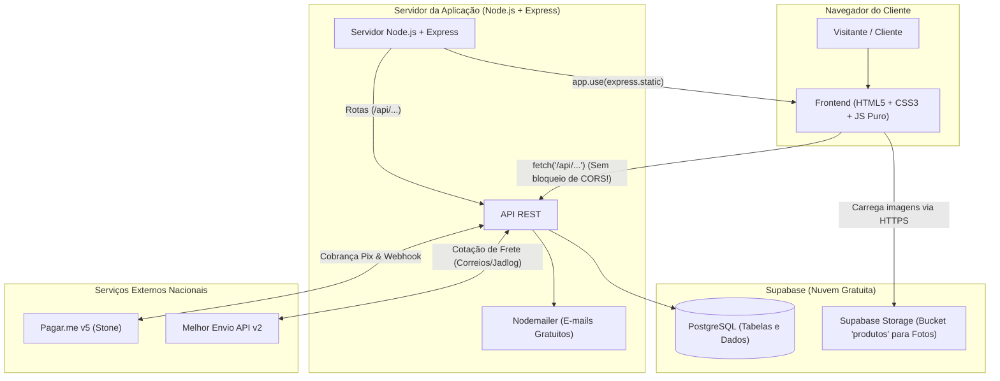
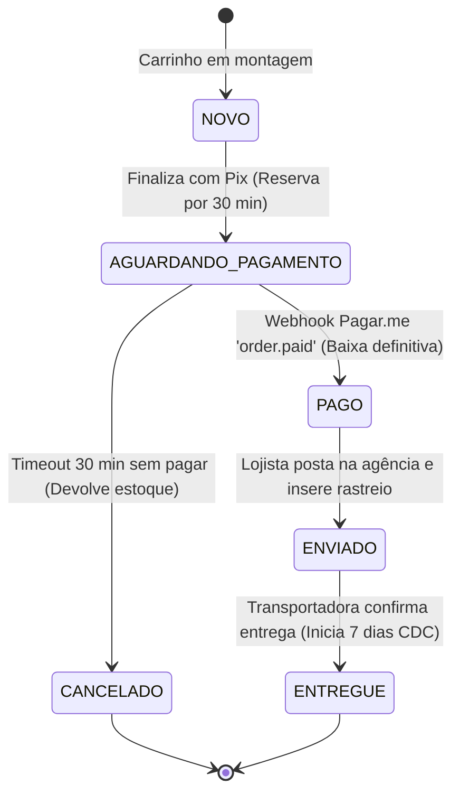

# 📜 Diretrizes e Especificação do Projeto — Canivete da Roça (PI2)

Documento oficial de alinhamento técnico, arquitetural e regras de negócio do **Projeto Integrador II (PI2)** para a plataforma de e-commerce **Canivete da Roça**.

---

## 🎯 1. Visão Geral e Escopo

* **Nicho do E-commerce:** Cutelaria artesanal, canivetes, facas, bainhas em couro, strops e pastas para polimento/afiação de lâminas.
* **Proposta Arquitetural:** Simplicidade máxima para estudantes (HTML5/CSS3/JS puro no Frontend + Node.js/Express no Backend), com persistência relacional e armazenamento de arquivos no **Supabase** (PostgreSQL + Supabase Storage).
* **Decisão de Infraestrutura:** **O serviço Render NÃO será utilizado.** A hospedagem da aplicação/API será definida separadamente pela equipe, mantendo a centralização dos dados no Supabase.
* **Modelo de Compra:** **Guest Checkout (Sem Login Obrigatório)**. O cliente preenche seus dados diretamente na finalização da compra, eliminando o atrito de senhas e aumentando a taxa de conversão. O acompanhamento de compras é feito via consulta rápida por **CPF ou Código do Pedido**.
* **Imagens de Produtos:** Hospedadas no **Supabase Storage** (armazenamento em nuvem gratuito de arquivos). O banco de dados guarda apenas o link (URL pública em texto).
* **Escopo de Pagamento:** Exclusivo via **PIX (Pagar.me v5)** com QR Code dinâmico e expiração estrita de 30 minutos.
* **Escopo Logístico:** Cálculo de frete dinâmico e cotações integradas à API do **Melhor Envio v2** (Correios PAC/SEDEX e Jadlog).
* **Notificações:** Disparo de e-mails transacionais gratuitos via **Nodemailer (Gmail)**.

---

## 🏗️ 2. Arquitetura Técnica e Stack

### 📊 Resumo das Ferramentas Escolhidas

| Camada | Ferramenta | Hospedagem / Nuvem | Custo | Finalidade Principal |
| :--- | :--- | :--- | :--- | :--- |
| **Frontend** | HTML5, CSS3, JS Vanilla | Servido junto com a API | R$ 0,00 | Telas leves, sem build, facilidade de edição por qualquer membro. |
| **Backend** | Node.js + Express | Servidor Node.js *(Sem Render)* | R$ 0,00 | Rotas limpas, leitura direta de JSON (`req.body`), regras comerciais. |
| **Banco de Dados**| **PostgreSQL** | **Supabase** (Free Tier) | R$ 0,00 | Armazenamento relacional de produtos, categorias, pedidos e clientes. |
| **Fotos / Imagens**| **Supabase Storage** | Bucket público (`produtos`) | R$ 0,00 | Hospedagem das fotos dos produtos; o banco guarda apenas a URL. |
| **Pagamentos** | API REST v5 (Stone) | **Pagar.me** (Sandbox / Prod) | Por transação | Pix com QR Code dinâmico, código copia-e-cola e Webhook `order.paid`. |
| **Logística** | API v2 de Cotação | **Melhor Envio** (Sandbox / Prod)| R$ 0,00 (API) | Cotação em tempo real de PAC, SEDEX e Jadlog com base no CEP. |
| **E-mails** | Nodemailer (SMTP Gmail) | Google App Password | R$ 0,00 (até 500/dia)| Confirmação imediata do pagamento e envio do código de rastreio. |

---

## 🖼️ 3. Gestão de Imagens — Supabase Storage

> [!IMPORTANT]
> **Regra de Ouro da Equipe:**  
> **NUNCA** guarde imagens binárias (arquivos pesados) dentro das tabelas do banco de dados (colunas BLOB/bytea). Isso esgota a memória, deixa o banco lento e estoura a cota gratuita rapidamente.

### Como funciona o Supabase Storage no projeto:
1. No painel do **Supabase**, acesse a aba **Storage** no menu lateral.
2. Crie um balde (*Bucket*) com o nome **`produtos`** e marque a opção **Public Bucket** (Balde Público).
3. Faça o upload das fotos dos canivetes, bainhas e kits arrastando os arquivos pelo próprio navegador.
4. Clique na imagem no Supabase e copie a **Public URL** (URL Pública):  
   `https://[id-do-projeto].supabase.co/storage/v1/object/public/produtos/canivete-campeiro.jpg`
5. Cole essa URL no campo **`imagem_url`** da tabela de produtos.
6. O frontend simplesmente renderiza: ``.

---

## 🗂️ 4. Categorias e Navegação no Menu Superior

Para permitir que o cliente filtre os produtos facilmente, o topo da loja contará com um **Menu Superior** com as principais seções da cutelaria:

1. **Todos** (exibe todo o catálogo)
2. **Canivetes** (`slug: canivetes`)
3. **Bainhas** (`slug: bainhas`)
4. **Kits de Afiação** (`slug: kits`)
5. **Polimento e Afiação** (`slug: polimento`)

### Como funciona a integração Menu $\leftrightarrow$ API:
* Quando o cliente clica em uma categoria no menu (ex: "Bainhas"):
  * O JavaScript faz a chamada: `fetch('/api/produtos?categoria=bainhas')`.
  * O Backend busca os produtos que possuem essa categoria no banco.
  * A vitrine é atualizada instantaneamente sem precisar recarregar a página inteira.

---

## 📦 5. Catálogo, Estoque e Regras de Negócio

### RN01 — Tipos de Produtos e Dimensões Físicas
1. **Itens Simples:** Peças avulsas (ex: canivete campeiro, bainha de couro, pasta de polimento verde).
2. **Kits e Combos:** Agrupamentos de itens (ex: *Kit Mestre da Afiação* = 1 Canivete + 1 Strop + 1 Pasta Verde).
   * **Controle de Estoque dos Kits:** A disponibilidade de um kit virtual é calculada automaticamente pelo item de menor saldo:  
     $$\text{Estoque do Kit} = \min(\text{estoque}_{\text{item 1}}, \text{estoque}_{\text{item 2}}, \dots)$$
3. **Obrigatoriedade para Frete:** Todo produto físico cadastrado deve obrigatoriamente possuir:
   * **Peso** (em gramas);
   * **Dimensões** (altura, largura, comprimento em cm).  
   * *Atenção:* A API do Melhor Envio rejeita cotações caso esses valores faltem.

### RN02 — Ruptura de Estoque ("Avise-me quando chegar")
* Quando o saldo de um item estiver zerado (`estoque <= 0`):
  * O botão **"Comprar"** é desabilitado.
  * Surge o formulário **"Avise-me quando chegar"** (coleta Nome e E-mail do cliente).
  * Os dados são salvos na tabela `avise_me` do Supabase.

---

## 💳 6. Pagamento Exclusivo via PIX (Pagar.me v5)

### RN03 — Modalidade Única
* A plataforma trabalha exclusivamente com **PIX**, evitando a complexidade de gateways de cartão de crédito e prevenindo fraudes/chargebacks.

### RN04 — Checkout, Reserva de Estoque e TTL de 30 Minutos
1. **Geração do Pix:** Ao clicar em "Finalizar Pedido", o backend cria uma `order` na API do Pagar.me com método `pix`.
2. **Retorno:** O Pagar.me devolve o código Pix "copia e cola" e a URL da imagem do QR Code.
3. **Reserva Temporária:** No instante da geração, os itens do pedido entram em estado de reserva no banco.
4. **Tempo de Expiração (TTL):** O Pix tem validade estrita de **30 minutos**.
   * A tela de checkout exibe um **cronômetro regressivo visual**.
   * Se o tempo expirar sem pagamento: o pedido passa para `CANCELADO` e os itens voltam ao estoque disponível da loja.

### RN05 — Webhooks e Confirmação Automática
* **Rota do Webhook:** `POST /api/webhooks/pagarme`.
* **Evento `order.paid`:**
  1. Altera status do pedido para `PAGO`.
  2. Confirma a baixa definitiva do estoque.
  3. Dispara e-mail automático de confirmação para o cliente via Nodemailer.
  4. Libera o pedido para a fila de expedição/embalagem.
* **Evento `charge.payment_failed`:**
  1. Altera status para `CANCELADO`.
  2. Devolve os itens para o estoque disponível.

---

## 🚚 7. Lógica de Frete e Logística (Melhor Envio v2)

### RN06 — Cotação Dinâmica de Frete
* **Chamada de Cotação:** Disponível na página do produto (estimativa unitária) e no carrinho/checkout (cotação consolidada).
* **Agrupamento de Pacote:** O backend soma o peso dos itens do carrinho e monta o pacote para a rota `/api/v2/me/shipment/calculate` do Melhor Envio.
* **Opções Exibidas:** Correios (PAC e SEDEX) e Jadlog (.Package e .Com), exibindo Nome do Serviço, Prazo em dias úteis e Valor em R$.

### RN07 — Pós-Pagamento e Rastreio
* Assim que o lojista posta o pedido, o código de rastreamento retornado pelo Melhor Envio é gravado no pedido no Supabase.
* O status avança para `ENVIADO` e o cliente recebe um e-mail com o link de rastreamento da encomenda.

---

## 🔄 8. Máquina de Estados do Pedido (Lifecycle)

---

## 📧 9. E-mails Transacionais Gratuitos (Nodemailer + Gmail)

Para manter o custo em **R$ 0,00**, o backend utiliza o **Nodemailer** conectado a uma conta Gmail do grupo com *Senha de Aplicativo*:
* Permite até **500 envios gratuitos por dia**.
* Dispara automaticamente e-mail com o resumo da compra e código de rastreio.

---

## 🗄️ 10. Modelagem do Banco de Dados (Supabase)

> [!NOTE]
> **Aviso para o DBA do Projeto:**  
> Os scripts [`database/schema.sql`](./database/schema.sql) e [`database/seed.sql`](./database/seed.sql) são **guias de referência e ponto de partida**. O responsável pelo banco de dados (DBA) tem total liberdade para adaptar tipos, nomes de colunas, índices e relacionamentos conforme a necessidade da equipe.

### Visão Geral das Tabelas Sugeridas:
1. **`categorias`**: Armazena as seções do menu (`Canivetes`, `Bainhas`, `Kits`, `Polimento`).
2. **`produtos`**: Informações comerciais, estoque, dimensões de frete (`peso_g`, `altura_cm`, etc.) e a URL do Supabase Storage (`imagem_url`).
3. **`kit_itens`**: Liga os produtos avulsos que formam um Kit.
4. **`pedidos`**: Registra as compras (Guest Checkout por CPF), frete escolhido e dados do Pix da Pagar.me.
5. **`pedido_itens`**: Produtos e quantidades de cada pedido.
6. **`avise_me`**: Fila de clientes interessados em produtos fora de estoque.

---

## 👥 11. Próximos Passos Imediatos para a Equipe

1. [ ] **DBA:** Acessar o Supabase, abrir o *SQL Editor*, revisar e executar o [`schema.sql`](./database/schema.sql) e [`seed.sql`](./database/seed.sql).
2. [ ] **DBA / Frontend:** Criar o bucket público **`produtos`** no Supabase Storage e subir as fotos iniciais.
3. [ ] **Backend:** Obter as chaves de teste do Pagar.me (Sandbox) e Melhor Envio (Sandbox).
4. [ ] **Grupo:** Criar e-mail no Gmail para o projeto e gerar a Senha de Aplicativo.
5. [ ] **Desenvolvimento:** Iniciar a codificação do layout base (`frontend/`) e do servidor Express (`backend/`).
